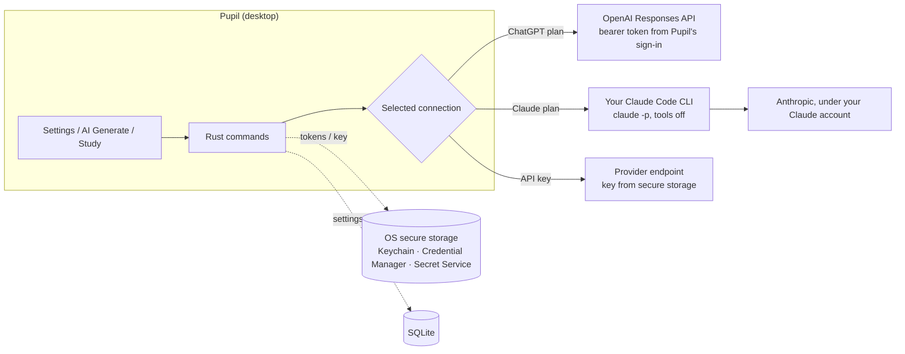

# Using an AI subscription in Pupil

Pupil can generate cards, regenerate a single card, and explain cards during study with an AI plan you already pay for, so you don't have to buy API credits separately. Settings → AI offers three connections:

| Connection | What you need | Who pays |
| --- | --- | --- |
| **ChatGPT plan** | A ChatGPT Plus or Pro plan that OpenAI makes eligible for plan usage in other apps | Your ChatGPT plan's usage limits |
| **Claude plan** | Claude Code installed on the same computer and signed in with a Claude Pro, Max, Team or Enterprise plan | Your Claude plan's usage limits |
| **API key** | An OpenAI, Anthropic, Gemini, OpenRouter, custom or local endpoint, as before | That provider's API billing |

Each connection is its own route. Pupil never falls back from one to another: if your ChatGPT session ends or your Claude plan hits its limit, the request fails with a clear message. It never quietly switches to a saved API key.

Generated cards still go through the same JSON validation and review-before-save step, and explanations use the same contract, whichever connection you pick.

## How each connection works

### ChatGPT plan

Pupil uses OpenAI's documented **ChatGPT plan usage for open-source and locally hosted apps** ([overview](https://developers.openai.com/siwc/token-sharing-open-source.md), [sign-in](https://developers.openai.com/siwc/token-sharing-open-source/sign-in.md)).

1. **Continue with ChatGPT** opens your browser at OpenAI's sign-in. Pupil registers itself dynamically (no client secret is involved) and listens on `127.0.0.1` for the redirect.
2. You sign in on OpenAI's page and allow plan usage. Pupil never sees your password.
3. Pupil exchanges the code using PKCE and checks the identity token's signature against OpenAI's published keys, plus its issuer, audience, nonce and expiry. It also confirms the `chatgpt.tokens.use.direct` scope was granted.
4. The access, refresh and identity tokens go to the OS secure store (Keychain on macOS, or the Stronghold vault elsewhere, whose password lives in the OS store). SQLite holds only the connection status, the account email for display, the issued client ID and an opaque host ID.
5. Requests go to `https://api.openai.com/v1/responses` with `store: false` and streaming, as the docs require. Access tokens are refreshed before they expire. Refreshes are serialized because refresh tokens rotate.
6. **Disconnect** clears the local tokens first, then revokes the refresh token with OpenAI. If OpenAI can't be reached, the tokens are still gone and Pupil says the remote revocation wasn't confirmed. A refresh that was already running when you disconnected can't write its tokens back or start a request; Pupil revokes whatever it received.
7. **Reconnecting** reuses the registration from your first sign-in, as OpenAI asks for a returning account. **Use a different account** registers afresh, which is how you switch to another ChatGPT account or workspace. If OpenAI stops recognizing the saved registration, Pupil drops it, so the next connect registers afresh. Your cards and settings stay as they are.

You can cap how much of your plan Pupil may use in ChatGPT → Settings → Usage → App limits ([help article](https://learn.chatgpt.com/docs/sign-in-with-chatgpt.md)). Pupil's **Manage usage** link opens that page.

Errors OpenAI defines for plan usage are surfaced as such: usage limit reached, not eligible, connection ended, model unavailable, and temporarily unavailable ([errors](https://developers.openai.com/siwc/token-sharing-open-source/errors-and-recovery.md)).

### Claude plan (through Claude Code)

Anthropic does **not** allow third-party apps to offer Claude.ai sign-in or to use Free/Pro/Max credentials directly. It **does** allow an end user to sign in to the unmodified Claude Code binary with their own subscription, including when another product runs Claude Code ([Claude Code legal and compliance](https://code.claude.com/docs/en/legal-and-compliance)). So Pupil:

- finds your own Claude Code install (checking PATH plus the usual install folders, because desktop apps don't inherit your shell's PATH), or uses a location you enter;
- checks `claude auth status` and only proceeds if Claude Code is signed in with a Claude subscription. Claude Code set up for API billing, Bedrock, Vertex or Foundry is refused, so nothing is billed to an account you didn't choose;
- runs `claude -p --output-format json` directly, never through a shell, with tools, MCP servers, slash commands and settings files turned off and session persistence disabled. It runs in an empty working folder, with the prompt on stdin and Pupil's system prompt in a private temporary file;
- removes `ANTHROPIC_API_KEY`, `ANTHROPIC_AUTH_TOKEN`, `ANTHROPIC_BASE_URL` and the cloud-provider switches from the child's environment;
- limits each run to 180 seconds and three at a time, and kills the process on timeout, cancel, or when you leave the screen.

Pupil never reads, copies or stores Claude credentials; sign-in stays inside Claude Code. To sign in, run `claude auth login` in a terminal. To sign out of Claude Code itself, run `claude auth logout`.

Model choices are Claude Code's aliases (**Opus**, **Sonnet**, **Haiku**), which resolve to the latest model in each family. Whether your plan includes a model is checked when you test the connection or make a request; an unavailable model gets its own message.

**Advertised Claude plan limits assume ordinary, individual use.** Pupil makes one request per generation, per regenerated card, or per explanation.

## What isn't supported, and why

- **Gemini / Google AI Pro or Ultra.** Gemini CLI stopped serving requests for Google AI Pro, Ultra and the free individual tier on June 18, 2026 ([Google Developers Blog](https://developers.googleblog.com/an-important-update-transitioning-gemini-cli-to-antigravity-cli/)). Its replacement, Antigravity CLI, is covered by terms that treat third-party tools reaching the service as a violation, and Google's FAQ names other harnesses as examples. Use a Gemini API key from Google AI Studio instead; it works with the API key connection.
- **Codex CLI as the ChatGPT route.** Codex also signs in with ChatGPT, but OpenAI's documented path for apps like Pupil is the plan-usage sign-in above. That path doesn't require installing an agent CLI, and Pupil holds a token scoped to plan usage rather than driving a coding agent.
- **Claude.ai sign-in inside Pupil.** Not permitted for third-party apps (see above); Claude Code is the supported route.
- **Browser preview.** The web preview (`bun run --cwd apps/app dev:web`) has no subscription connections; it keeps the mock API-key preview.

## Platform notes

| | ChatGPT plan | Claude plan |
| --- | --- | --- |
| macOS | Supported. Tokens in Keychain. | Supported. Finds `~/.local/bin/claude`, `~/.claude/local`, Homebrew and npm installs. |
| Windows | Supported. Tokens in Stronghold, password in Credential Manager. | Supported for the native `claude.exe` only, with no console window. The npm `claude.cmd` install is refused: stopping it would leave Claude running after Cancel or a timeout. Not yet tried on a real Windows machine. |
| Linux | Supported. Tokens in Stronghold, password in Secret Service (a keyring daemon must be running). | Supported. Same discovery as macOS. |

The loopback sign-in uses `127.0.0.1:1455` when it's free, and otherwise any free port.

### What has been verified

- **Claude plan:** live runs on macOS with a Claude Max plan: Opus generated valid cards, Sonnet produced an explanation, an unknown model got the right error.
- **ChatGPT plan:** sign-in, refresh, retry, disconnect and re-registration were run against a local mock of OpenAI's endpoints, and OpenAI's live discovery and keys endpoints were checked. A real sign-in and request with a Plus or Pro account has not been run yet.
- **Not yet run:** the full flow inside the native desktop window (Settings → generate → review and save → study explanation), and either connection on a real Windows or Linux machine. CI compiles both.

## Privacy

Card text, topics and prompts go to the provider of the connection you choose (OpenAI, or Anthropic through Claude Code), under your account and subject to that provider's terms. Pupil adds no server in between. Nothing about subscriptions is written to logs, and IPC responses carry connection status, never tokens.
